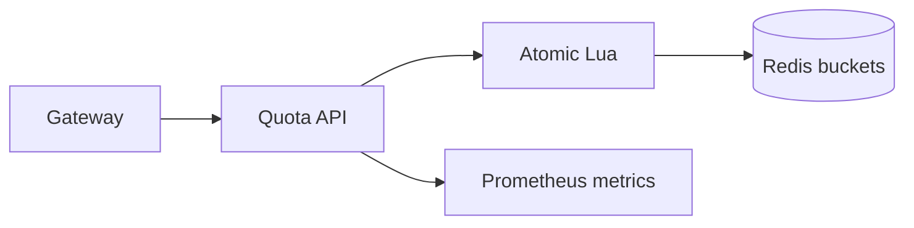

# Quota Lab

[](https://github.com/borikhan/quota-lab/actions/workflows/ci.yml)
[](https://go.dev/)

A tenant-aware token-bucket quota service in Go, with both a concurrency-safe local implementation and an atomic Redis Lua algorithm for distributed deployments.

## Engineering highlights

- Continuous token refill allows bursts without losing long-term rate guarantees
- Decisions return remaining capacity and an actionable retry delay
- Tenant isolation is explicit in every check
- Redis Lua performs read/refill/consume/write atomically across API replicas
- Prometheus-format counters expose allowed and rejected traffic



## Quick start

```bash
go test -race ./...
go run ./cmd/server
curl -i -X POST localhost:8080/v1/check -H 'X-Tenant-ID: acme'
```

Capacity and refill rate are externalized in [`.env.example`](.env.example). `GET /metrics` exposes low-cardinality decision counters.

Read [architecture and operations](docs/architecture.md) for distributed correctness, failure policy, cardinality controls, and twelve-factor design.

## License

MIT
